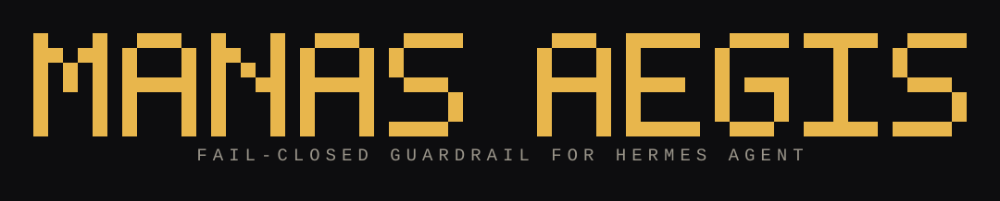

<div align="center">



# Manas Aegis

[Repository](https://github.com/elianjuan-g/hermes-manas-aegis) · [Catalog PR #151504](https://github.com/NousResearch/hermes-agent/pull/151504)

[](https://github.com/elianjuan-g/hermes-manas-aegis#readme)
[](LICENSE)


</div>

**Manas Aegis is a fail-closed guardrail plugin for Hermes Agent: before Hermes runs a tool, it checks the tool's arguments against 10 enforced rules and blocks, rewrites, or redirects what matches — with a local dashboard (HUD) that shows every decision, a Posture Score, a Guard Arena, and live global threat intelligence. It is an ALPHA prototype (v2.6.3-alpha), opt-in, for non-sensitive test environments only — not standalone security, not a device scanner, and not a guarantee that no attack gets through.**

> **ALPHA / PROTOTYPE — v2.6.3-alpha**
>
> Install only if you choose to try it (**opt-in**), and only in a
> **non-sensitive test environment** — not on a production machine,
> not to protect secrets, and not as your only security control.
>
> Do not install this plugin and then feel that your computer is safe.
> It checks only part of Hermes Agent's tool activity, before the tool
> runs. It is **not** a scanner of your whole computer, **not** a CVE
> scanner for all installed software, and **not** a guarantee that no
> attack gets through.

## Features

| | |
|---|---|
| **10 enforced rules** | All 10 rules in the catalog are enforced (status experimental — pattern-based, not planned) since v2.6.0-alpha: git RCE, credential honeypot, SSRF sinkhole, webhook auth, config injection, memory firewall, symlink guard, SQL injection, shell RCE, and call-ID race. See the [guard table](#guard-table). |
| **Posture Score** | One number, 0–100, plus a grade (A–F) for current protection posture, from five components: rules 25, enforcement 25, hygiene 20, intelligence 15, activity 15. A local summary, not a security certificate. |
| **Guard Arena 10/10** | 10 attack scenarios (text only, never executed) run against the same runtime enforcement path on a disposable core. Results are stored and shown in the Arena tab. |
| **Live threat intel** | Global advisories from **CISA KEV** and **NVD CVE API 2.0** (both free, no key, official), cached locally (max. 40 items), refreshed automatically every 10 minutes when the cache is older than 6 hours. Shown as global awareness — the plugin does NOT check whether this device is affected. |
| **Loopback HUD** | Local dashboard at `http://127.0.0.1:18777` with Host-header check (loopback only), CSRF token on all POSTs, rate limit 20 POST/IP/60 seconds (HTTP 429), and token auth (`hud_auth_token`) — a token is generated automatically on first run when none is configured (stored in the state directory, mode 0600). The Desktop app embeds it via the SDK `SandboxedFrame`. Dark + light themes, 15 languages, English default. |
| **Time-travel audit** | Re-checks stored runtime events and marks events that would only now be caught by the R3 mechanisms. A pattern-based audit over stored evidence — not a full replay. |
| **15 languages** | English (default), Indonesian, Spanish, French, German, Portuguese, Italian, Russian, Turkish, Arabic, Hindi, Chinese, Japanese, Korean, Vietnamese. Rule names, advisory IDs, and CWEs are not translated. |
| **Custom rules** | Add your own rules and override four built-in patterns, validated on load. Valid custom rules really run in the engine and appear in the HUD catalog with a "custom" badge. |
| **On-demand scans** | Quick, full, and network scans. Findings are stored (max. 50) and shown in the Findings tab — that is this plugin's "notification"; there is no push channel. |
| **Unlimited history + search** | The 120-event cap is removed. The live file keeps the newest 500 events; older events move to an append-only archive that the plugin never deletes (except via "Clear history"). Search across live history and archive. |

## Contents

- [Quick Start](#quick-start)
- [How it works](#how-it-works)
- [What it prevents — and what it does NOT prevent](#what-it-prevents--and-what-it-does-not-prevent)
- [Guard table](#guard-table)
- [Posture Score, Guard Arena, and time-travel audit](#posture-score-guard-arena-and-time-travel-audit)
- [HUD hardening](#hud-hardening)
- [Scans: quick, full, network](#scans-quick-full-network)
- [Threat intelligence](#threat-intelligence)
- [HUD design and languages](#hud-design-and-languages)
- [Configuration](#configuration)
- [Testing](#testing)
- [Data stored](#data-stored)
- [Troubleshooting](#troubleshooting)
- [Uninstall / rollback](#uninstall--rollback)
- [Tested Hermes versions](#tested-hermes-versions)
- [Reporting a security vulnerability](#reporting-a-security-vulnerability)
- [Glossary](#glossary)
- [Contributing](#contributing)
- [License](#license)

## Quick Start

Verified path:

1. Copy this plugin directory to `~/.hermes/plugins/hermes-manas-aegis`.
2. Enable the plugin in Hermes.
3. Verify with:

   ```sh
   hermes plugins validate ~/.hermes/plugins/hermes-manas-aegis
   ```

> [NOT YET VERIFIED] The detailed steps to enable the plugin through
> the Hermes interface, and the command `hermes plugins validate <dir>
> --install-deps`, have not been verified from a clean install on this
> machine. If the command above fails, see [Troubleshooting](#troubleshooting)
> and report the result (see [CONTRIBUTING.md](CONTRIBUTING.md)).

What is **not** verified yet, and therefore **not** promised:

- Installation via the Python package (wheel). Since v2.6.2 the sdist
  and wheel do carry `plugin.yaml` + desktop assets + honeypot decoys
  (verified from the contents of the built archives), but installing
  through the official Hermes package path from a clean install is
  still unverified.
- Compatibility with Hermes versions other than the tested ones (see
  [Tested Hermes versions](#tested-hermes-versions)).

### Enable / disable

- **Using the plugin:** enable it in Hermes, then start a Hermes
  session as usual. When the plugin runs, the HUD is available (see
  [Verifying success](#verifying-success)).
- **Turning the plugin off:** disable the plugin in Hermes, or delete
  the plugin directory (see [Uninstall / rollback](#uninstall--rollback)).
  After that, Hermes runs without Manas Aegis checks.
- **Turning off only the HUD:** set `auto_launch_hud_server` to `false`
  in the plugin configuration (see [Configuration](#configuration)).
  The HUD no longer starts automatically when a session begins.

> [NOT YET VERIFIED] The menu names and click steps for enable/disable
> in Hermes Desktop have not been verified from a clean install. If the
> menus on your machine differ, deleting the plugin directory is the
> most certain way to turn it off.

### Verifying success

When the plugin runs, you will see:

1. **HUD at `http://127.0.0.1:18777`** — the local dashboard showing
   plugin status and event history. It opens with a login page first
   (token in the state directory — see [HUD hardening](#hud-hardening)).
   If the page cannot be opened at all, the HUD is not running (see
   [Troubleshooting](#troubleshooting)).
2. **Events recorded** — when a rule handles an activity, one event
   appears in the HUD history and is stored in `manas_telemetry.json`
   (see [Data stored](#data-stored)).

How to read the HUD correctly:

- **A calm first screen is normal.** On a fresh install with no
  history, the correct display is: *"No activity matching the
  protection rules yet."* That means no activity has been handled
  yet — **not** that your computer is free of vulnerabilities.
- **Numbers in the HUD = stored local events** (unlimited history:
  live file with the newest 500 events + archive of all older events —
  see [Data stored](#data-stored)), not the number of attacks on the
  internet and not a device-scan result.
- **`HERMES-SEC-...` IDs are internal advisory IDs**, not public CVEs.
  Do not read them as "CVEs found on my device".
- **Simulations are labelled SIMULATION.** The simulation button runs
  6 local example inputs against the rules — that is practice, not a
  real attack, and its results are not counted as real activity.
- **"Active" status only means the plugin is registered on the hook.**
  If the connection status cannot be verified yet, do not assume
  protection is running.

## How it works

Manas Aegis is a **guardrail** plugin for Hermes Agent. It works
simply:

1. Before Hermes runs a tool, the plugin checks the tool's arguments
   (the command contents).
2. If the arguments match one of the rule patterns, the plugin can
   **block** (the tool does not run), **modify** the arguments (for
   example adding safe flags to a git command, or replacing a dangerous
   pattern with substitute text), or **redact** sensitive content in
   the tool's result.
3. Every plugin action is recorded as an event in a local file on your
   computer, and can be viewed in the local web dashboard (HUD).

All checks are done with **text pattern matching (regex)** — not with
a language parser, not with a sandbox, and not with a network
firewall. That is why there are known gaps — see the guard table
below. Since v2.6.0-alpha, chained commands are split per segment by
a real shell parser, and credential paths are canonicalized before
checking.

### Architecture

- **Hook path:** `pre_tool_call` intercepts tool calls before
  execution; `pre_llm_call` only raises the session risk multiplier
  to 1.95 when a memory-poison pattern matches in the last 3 messages,
  and **always returns None** — it never blocks or filters any LLM
  message.
- **Enforcement engine:** `core_engine.py` — pattern checks, shell
  parser, taint tracking (per session, 60-minute TTL, in-memory only),
  SSRF evaluation (fail-closed), symlink/call-ID enforcement.
- **State files:** local JSON/JSONL in the plugin state directory
  (telemetry, archive, STIX bundle, scan state, threat-intel cache,
  config baseline, arena + time-travel results).
- **HUD server:** loopback-only HTTP server (`127.0.0.1:18777`,
  `ThreadingHTTPServer`) serving the dashboard and its API, with a
  Host-header check, CSRF token on POSTs, rate limit, and token login.
  It runs inside the Hermes gateway process.
- **Threat intel fetcher:** `threat_intel.py` fetches CISA KEV + NVD
  over HTTPS (public, no key) only for the global threat-intel panel.
- **No LLM call, no subprocess, no credentials read, no telemetry
  sent out** by the plugin itself.

### What is monitored

The "What is monitored" panel in the HUD summarizes this plugin's
scope:

- **What is monitored:** part of Hermes Agent's tool activity matching
  the 10 experimental rules (see the guard table below — since
  v2.6.0-alpha there are no more planned rules). Activity matching no
  pattern is not recorded.
- **What is NOT scanned:** this plugin does NOT scan the whole
  computer, all applications, or all vulnerabilities on the device.
  It is not a CVE scanner and not an antivirus.
- **Custom rules:** you can add your own rules and edit certain
  built-in ones — see below. Rules you add really run in the engine
  (not just decoration), and are validated before use.

### Custom rules

File: `<hermes home>/plugin-data/hermes-manas-aegis/manas-aegis-custom-rules.json`
(in the plugin state directory, NOT inside the plugin directory — so
your rules are not deleted when the plugin is reinstalled; rules from
the old `~/.hermes/manas-aegis-custom-rules.json` location are copied
over automatically on first run).

Format:

```json
{
  "rules": [
    {
      "rule_id": "CUSTOM-BLOCK-BAD-WORD",
      "codename": "CUSTOM-BLOCK-BAD-WORD",
      "pattern": "company-secret",
      "tools": ["sqlite_query"],
      "test_positive": "read company-secret from db",
      "test_negative": "read monthly report from db"
    }
  ],
  "overrides": {
    "MANAS-SQLI-AST": "SELECT\\s+.*\\bOR\\b\\s+['\"]?1['\"]?\\s*=\\s*['\"]?1['\"]?"
  }
}
```

- `rules`: list of new rules. Each rule must have a `rule_id` (must
  start with `CUSTOM-`, unique), `codename`, and `pattern` (regex).
  `tools` (optional) limits the rule to specific tool names; when
  empty, the rule applies to all tools. `test_positive` /
  `test_negative` (optional but recommended) prove your pattern is
  right: `test_positive` must match the pattern, `test_negative` must
  not match.
- `overrides`: replace the main pattern of a built-in rule. Only
  rules with a single main pattern can be overridden:
  `MANAS-SQLI-AST`, `MANAS-SHELL-RCE`, `MANAS-CONFIG-FIM`,
  `MANAS-MEM-FIREWALL`. Overrides of other rules are rejected and
  logged as errors.
- **Validation:** the file is read when the plugin loads. Invalid
  entries (regex that does not compile, wrong `rule_id`, failing
  positive/negative tests, override of an unknown rule) are
  **rejected and logged as errors** — the plugin never dies because
  of a broken rules file. Errors are visible in the HUD ("What is
  monitored" panel) and in `get_system_posture()`.
- **Reload:** rules are read when the plugin loads. After editing the
  file, reload the plugin (or restart the Hermes session) for the new
  rules to take effect.
- Valid custom rules appear in the HUD catalog table with a "custom"
  badge, complete with an explanation built from the rule's
  description and pattern.

## What it prevents — and what it does NOT prevent

### What can be prevented (within known patterns)

- Specific git commands rewritten with safe flags.
- Reads of recognized credential files — redirected to a decoy file
  or blocked, depending on settings.
- URLs clearly pointing at private/loopback/cloud-metadata addresses —
  blocked before the tool runs.
- Recognized SQL injection and destructive shell command patterns —
  blocked.
- Injection patterns on hook configuration and on memory tools.

### What it does NOT prevent — read this before using

- **Not a sandbox.** The plugin does not limit what the operating
  system, the network, or tools that do not pass through the Hermes
  hook can do. Commands that do not match a pattern will get through.
- **Not a network firewall.** The plugin only checks URLs in tool
  arguments. It does not bind the next connection to the checked IP,
  does not check redirects, and does not enforce an egress policy.
- **Not your only security control.** Do not make this plugin the sole
  protector of your file, network, or secret access.
- **Not a CVE scanner.** Numbers and IDs shown in the HUD are
  **internal advisory IDs** (`HERMES-SEC-...`) and reference values
  from the rule catalog — not public CVEs and not a scan result of
  your device.
- **Not a system patch.** "Modifying arguments" here only changes the
  arguments returned to Hermes. The plugin does not patch any software.
- **All rules active.** All 10 rules in the catalog are **enforced**
  (status experimental — pattern-based, not planned). Since
  v2.6.0-alpha there are no more planned rules — see the table.
- **If the hook fails or the plugin dies**, there is no protection
  from the plugin. Hermes keeps running as usual without these checks.

## Guard table

Status:

- **experimental** — the checking code exists, but it is pattern-based
  and has known gaps. Do not rely on it as a sole safeguard.
- **planned** — only the name exists in the rule catalog. **No**
  checking runs. (In v2.6.0-alpha: no more planned rules — all 10
  rules are enforced.)

| Rule | Threat | Trigger | Action | Status | Known limits / bypasses | Recorded data |
|---|---|---|---|---|---|---|
| MANAS-GIT-FS-RCE | Git commands exploiting dangerous repo config (CWE-78) | Git `status`, `diff`, `log`, `checkout`, `pull`, `fetch`, or `clone` in `command`/`cmd`/`script` arguments | modify | experimental | Only the subcommands above are rewritten. Since v2.6.0-alpha chained commands are split per segment by a real shell parser — each segment is checked and rewritten on its own. Not a shell sandbox. | Rewritten git command (first 110 chars max.) |
| MANAS-CRED-HONEYPOT | Credential file reads (CWE-522 / CWE-73) | Arguments containing a recognized credential path (e.g. `.hermes/auth.json`, `.env`, SSH keys, `.aws/credentials`) on read operations — including inside nested dicts/lists and written as `~/...` | modify / block | experimental | Substring matching on argument text (recursive into nested dicts/lists), plus canonicalization since v2.6.0-alpha: symlinks are resolved, `~` is expanded, and reads pointing at protected files are redirected to a decoy (MANAS-SYMLINK-GUARD). Other path/encoding variations can still slip through. | Matching path and decoy destination path (when redirected) |
| MANAS-SSRF-SINKHOLE | Requests to internal / cloud-metadata addresses (CWE-918) | `http(s)://...` URLs in tool arguments pointing at private, loopback, link-local, reserved, multicast, unspecified IPs, `localhost`, or metadata hosts | block | experimental | **Since v2.6.0-alpha a failed DNS is treated as UNSAFE (fail-closed)** — the request is blocked. Hosts in `ssrf_allowlist` are exempt. The DNS check result does not bind the next connection, and redirects are not checked. | URL and blocking reason |
| MANAS-WEBHOOK-AUTH | Oddly shaped webhook session ID (CWE-863) | `session_id` starting with `webhook:` and containing more than 2 colon (`:`) characters | block | experimental | Only checks the **shape** of the session ID, **not webhook authentication**. A normally shaped but fake session ID is not detected. | Blocked session ID |
| MANAS-CONFIG-FIM | Hook injection in configuration (CWE-94) | Config-hook injection text patterns in tool arguments | block | experimental | Only blocks text patterns. The config fingerprint (size + mtime + inode — file contents are never read) is now **re-compared** by quick scan against the persistent baseline (`cce_baseline.json`) — changes are reported as findings. This is still **not** real FIM (no real-time file monitoring, and deleting `cce_baseline.json` creates a new baseline from the current state). | Argument snippet (160 chars max.) |
| MANAS-MEM-FIREWALL | Directive injection into memory (CWE-74) | Directive-injection patterns in arguments of tools whose name contains `memory` | modify | experimental | Only applies to tools whose name contains "memory". Patterns outside that are untouched. | Note that the pattern was cleaned from the arguments |
| MANAS-SYMLINK-GUARD | Symlink / TOCTOU attacks (CWE-59) | Arguments containing a path that, after resolving (symlinks, or expanded `~`), points at a recognized credential file | modify | experimental | Only applies to read operations. TOCTOU (symlink swapped after the check) is not prevented — this is not a filesystem lock. | Matching path and decoy destination path (when redirected) |
| MANAS-SQLI-AST | SQL injection (CWE-89) | SQL injection regex patterns in tool arguments (argument text joined into one string) | block | experimental | **Not a SQL AST parser** — only pattern matching. New, unknown patterns can slip through; normal text that happens to look like a pattern can be blocked. | Argument snippet (160 chars max.) |
| MANAS-SHELL-RCE | Destructive shell commands (CWE-78) | Destructive shell command regex patterns in tool arguments | block | experimental | Only known patterns. Since v2.6.0-alpha chained commands are split per segment and dangerous `python -c` forms are blocked by the per-segment shell parser; since v2.6.2-alpha splitting also respects `$(...)`/backticks and newlines, and `rm -rf` to any absolute path is blocked. Since v2.6.3-alpha the RCE pattern's lazy segments are bounded to 256 characters and the scanned length is capped at 8 KB, so a 40 KB near-miss input is checked in ~0.1 s (measured). Not a shell sandbox. | Argument snippet (160 chars max.) |
| MANAS-CALLID-RACE | Cross-session call-ID race condition (CWE-362) | The same tool call (session + tool + same argument hash) within 10 seconds | block | experimental | Only applies to runtime calls; simulation is exempt. The 10-second window is configurable (`callid_race_window_s`). | Tool name and argument hash |

Note on the numbers in the table and in the HUD: values such as CVSS,
CWSS, EPSS, and SSVC are **reference values written in the rule
catalog**, not measurements of your device. Do not read them as "my
computer's risk score". The "standards enforced" number in the old
README was a **static value written directly in code**
(core_engine.py:297) — not the result of checking that many standards;
the old README itself only named about 12 frameworks. That number is
no longer used in this document.

## Posture Score, Guard Arena, and time-travel audit

### Posture Score

The score card in the HUD gives one number, 0–100, plus a grade (A–F)
for current protection posture, from five components:

- **Rules (25):** enforced rules / defined rules.
- **Enforcement (25):** minus 5 per critical scan finding, and 10 when
  the SSRF firewall is turned off.
- **Hygiene (20):** minus 10 when there is a custom-rule error, and 10
  when there is a critical config-integrity finding.
- **Intelligence (15):** 15 when the intel cache is fresh, 7 when stale,
  0 when never fetched.
- **Activity (15):** 15 when there was an event/scan in the last 24
  hours, 7 when there was activity before, 0 when never.

This score is a **local posture summary**, not a security certificate.
A score of 100 does not mean your computer is safe — only that the
conditions this plugin measures are currently good.

### Guard Arena

The **Arena** tab in the HUD runs 10 attack scenarios (text only, never
executed) against the same enforcement path as runtime — on a disposable
core, so it does not pollute your telemetry. Results are stored
(`arena_last.json`) and shown as a table of scenario / expected /
result / PASS–FAIL. The **Run Arena** button re-runs all ten scenarios.
The Arena proves the rules actually work, not just that they are listed
in the catalog. **Current result: 10/10.**

### Time-travel audit

The **Run Time-travel audit** button re-checks stored runtime events
and marks events that would **only now be caught** by the R3 mechanisms
(`python -c` parser, symlink guard, SSRF fail-closed) although the old
rules did not catch them. This is a **pattern-based audit over stored
evidence** — not a full replay (telemetry does not store "allow" events
and evidence is truncated / reduced), so the result is an honest
estimate, not absolute proof. Call-ID race is not judged by this audit
(it cannot be judged from a single event alone).

### HUD hardening

- **Host check** — requests whose `Host` header is not
  `127.0.0.1:<port>` or `localhost:<port>` are rejected (HTTP 403).
  The HUD is loopback-only.
- **CSRF token** active on all POSTs (per-process token, sent via the
  `X-CSRF-Token` header). The token is embedded in the HUD page only
  after a successful login — never on an unauthenticated GET.
- **Rate limit:** max. 20 POSTs per IP per 60 seconds (HTTP 429 when
  exceeded).
- **Token auth (on by default):** the HUD login page requires a token
  (submitted once, then a 24-hour HttpOnly session cookie). If
  `hud_auth_token` is set in the plugin configuration, that token is
  used; otherwise a token is generated once on first run and stored in
  the plugin state directory (`hud_auth_token.txt`, mode 0600) — the
  login page shows the file path. The Desktop app embeds the HUD via
  the SDK `SandboxedFrame` and reads the port from the plugin config
  (default 18777), so the login page is reachable from the app.

## Scans: quick, full, network

Three scan buttons in the HUD run **on-demand** checks (one-shot, not
continuous monitoring). Results are stored and shown in the **Findings**
tab in the HUD — that is this plugin's "notification". The plugin has
**no** push channel (no system notifications, email, or chat messages).
Real-time blocking still appears in the Activity table as soon as it
happens.

### Quick scan

A fast check without reading your file contents:

- **Config integrity** — stat fingerprints (size, mtime, inode — the
  file contents are never read) of monitored config files are compared
  against the persistent baseline (`cce_baseline.json`). A changed file
  = critical finding; a new/missing file = warning. The baseline is
  created automatically the first time the plugin runs.
- **Honeypot decoys** — whether the decoy files (`decoy_auth.json`,
  `decoy.env`) still exist. A missing decoy = critical finding.
- **Custom rules** — whether any custom rules are invalid (see
  "Custom rules" above). Validation errors are reported.
- **Telemetry backstop** — whether any secret or injection pattern
  slipped into stored evidence (a sign that redaction is imperfect).
  A secret in stored evidence = critical finding.
- **Rule self-test** — the last simulation: how many of 6 examples
  matched the rules. If no simulation has ever run, recorded as info;
  if any example did not match, recorded as a warning.

### Full scan

All quick-scan checks, plus content scanning:

- **File contents in `~/.hermes`** — text files (max. 300 files, max.
  1 MB per file) are scanned for prompt-injection patterns, zero-width
  characters (markers of hidden injection), secrets outside known
  credential files, and token-bomb heuristics (extreme token repetition
  or giant spaceless lines that could flood a model's context).
  Credential files (`.env`, `auth.json`, `config.yaml`) are skipped
  entirely — they are never opened, so their contents are never read;
  their integrity is covered by the config-integrity fingerprint check
  above.
- This plugin's own directories are **not** scanned (they contain
  detection patterns and simulation examples — scanning them would only
  produce false positives), symlinks are not followed, and the
  `.git` / `node_modules` / `__pycache__` / `honeypot_sandbox`
  directories are skipped.

### Network scan

**Not** a port scan and **not** a LAN/internet scan. A network scan only
checks **this plugin's own network posture**:

- **HUD loopback** — whether the HUD server is still bound to
  `127.0.0.1` (not to an external network address).
- **State-file permissions** — whether plugin state files are
  world-writable. Files readable by others only are not treated as a
  problem (that is the normal umask default).
- **SSRF posture** — whether the SSRF evaluator is active, how many
  SSRF attempts have been blocked, and the known limitation note (a
  failed DNS is treated as UNSAFE — fail-closed since v2.6.0-alpha).

### What scans do NOT do

- They do not scan the whole computer, all applications, or all device
  vulnerabilities.
- They do not scan the network (no port scan, no scanning of other
  hosts).
- They do not fix anything automatically — a scan only **reports**
  findings. Acting on a finding is still your decision.

Findings are stored in `scan_state.json` (max. 50 findings, duplicates
merged and time-updated) and shown in the Findings tab. Clearing history
from the HUD also deletes scan findings.

## Threat intelligence

The **Threat intel** tab in the HUD has two parts:

1. **Rule catalog** — the 10 built-in rules (plus your custom rules).
   Each row now has an **Explanation** column with two levels:
   **"For everyone"** (plain language: what this rule does, in ordinary
   words) and **"For security professionals"** (patterns/triggers and
   their limits). Explanations are available in English and Indonesian;
   other languages show the English explanation.
2. **Latest global intel** — advisories from official sources, fetched
   automatically when Hermes is on and there is internet.

### Sources and updates

- **CISA Known Exploited Vulnerabilities (KEV)** —
  `https://www.cisa.gov/sites/default/files/feeds/known_exploited_vulnerabilities.json`
  (list of vulnerabilities known to be actively exploited).
- **NVD CVE API 2.0** —
  `https://services.nvd.nist.gov/rest/json/cves/2.0?resultsPerPage=20&sortBy=published&sortOrder=desc`
  (newest published CVEs).
- Both are free, without an API key, and official. Data is fetched for
  at most the 40 newest items and stored in a local cache
  (`threat_intel.json`).
- **Automatic updates:** the HUD server checks the cache every
  10 minutes and re-fetches when the cache is empty or older than
  6 hours. There is also a **"Refresh intel"** button in the HUD for a
  manual re-fetch.
- **Without internet:** the old cache stays displayed and the HUD
  clearly writes that the data may be stale or the source unreachable.
  If both sources fail, the old cache is kept (not deleted).

### Network disclosure (honest)

The plugin makes network calls **only** for the global threat-intel
panel described above:

- It fetches CISA KEV and NVD CVE API 2.0 over HTTPS (public, no key).
  No other destination is contacted.
- Auto-refresh checks the cache every 10 minutes and re-fetches when
  empty or older than 6 hours (max. 40 items, 12-second timeout, 2 MB
  cap).
- Without internet, the old cache is kept and labelled possibly stale.
- No LLM call, no subprocess, no credentials read, no telemetry sent
  out.

### What threat intel is NOT here

- This is **not** a scan of your device. Global advisories are shown
  as **awareness** — the plugin does NOT check whether this device is
  affected by any advisory.
- Do not read a global intel row as "a vulnerability found on my
  device". If you want to know whether a CVE affects your software,
  check the installed software versions and compare them with the
  advisory.

## HUD design and languages

The HUD was redesigned in v2.5.0-alpha from the **C3iHub CISO dashboard
design system (IIT Kanpur, 2024)** — an enterprise security platform
actually shipped to clients (an international insurance company), not a
Dribbble concept. References:
<https://fulloflyf.com/work/ciso-dashboard/> and
<https://www.aufaitux.com/blog/cybersecurity-dashboard-ui-ux-design/>.

- **Colour tokens (dark):** slate page `#2A2C38`, cards `#1E1F27`,
  sidebar `#1F1F3B`, action blue `#0168FF`, selected nav `#2F2263`.
- **One severity scale everywhere:** Critical `#F53821`,
  High `#FF9B10`, Medium `#FFCE20`, Low `#00D796`,
  Informative `#80CAFF` — used on KPI cards, source badges, finding
  severity badges, and intel level badges. Strong colours only for
  meaningful things; blue only for actions. Badges always have a dot +
  label (not colour alone).
- **Dark + light themes.** Theme button at the top right of the HUD.
  Light theme: page `#F2F3F5`, white cards `#FFFFFF`, white sidebar;
  same severity hues but darkened for contrast on white. Choice stored
  in the browser (localStorage `manas-aegis-theme`); default dark.
- **Typography:** system sans-serif UI (Inter/Segoe UI); monospace only
  for data values (timestamps, IDs, evidence).
- **Icons:** inline Lucide-style SVG (24px grid, stroke 2,
  currentColor). No emoji as icons.
- **Layout:** fixed left sidebar (Activity / Threat intel / Findings),
  main content max-width 1120px; on narrow screens (<760px) the sidebar
  collapses to a top bar.

### Languages

The HUD is available in **15 languages**: English, Indonesian, Spanish,
French, German, Portuguese, Italian, Russian, Turkish, Arabic, Hindi,
Chinese, Japanese, Korean, and Vietnamese.

- **The default language is English.**
- Choose a language from the menu at the top right of the HUD. The
  choice is stored in the browser (localStorage) and reused next time
  you open the HUD. You can also choose a language via URL:
  `http://127.0.0.1:18777/?lang=id`.
- Rule names, advisory IDs, and CWEs are not translated (they are
  identifiers, not sentences).
- The "for everyone" and "for security professionals" explanations are
  available in English and Indonesian; other languages show the English
  explanation.
- Adding a new language: add one language dict in
  `hermes_manas_aegis/i18n.py` with all the same keys as the English
  dict (there is an automatic check that rejects missing keys), then add
  the `(code, name)` pair to `SUPPORTED_LANGS` in the same file.

## Configuration

These options live in `plugin.yaml` (`config_schema`):

| Option | Default | What it actually does |
|---|---|---|
| `tactical_doctrine` | `counter_deceive` | Changes **credential-read behaviour only**. `counter_deceive`: credential file read operations are redirected to a decoy file. **`ssvc_enforce` and `stealth_audit` have no behaviour at all in code** — both are only enum values in `plugin.yaml`; there is no SSVC gate anywhere. The only doctrine branch in code is `if doctrine == "counter_deceive"` (core_engine.py:428): other doctrines make CRED-HONEYPOT fall through to the HARD_BLOCK path (block). Doctrine does **not** add other enforcement, and does not make SSVC block all ACT/ATTEND decisions. |
| `auto_launch_hud_server` | `true` | When `true`, the HUD starts automatically when the plugin is registered. When `false`, the HUD does not start automatically. |
| `hud_port` | `18777` | Local HUD port. The HUD only listens on loopback (`127.0.0.1`). |
| `git_rce_synthesis` | `true` | When `true`, recognized git commands are rewritten with safe flags (see MANAS-GIT-FS-RCE). When `false`, git rewriting is turned off. |
| `ssrf_dns_firewall` | `true` | When `true`, URLs in tool arguments have their DNS checked and URLs to internal addresses are blocked (see MANAS-SSRF-SINKHOLE). When `false`, SSRF checking is turned off. Note: a failed DNS is treated as **UNSAFE (fail-closed)** since v2.6.0-alpha — the request is blocked. |
| `taint_ttl_minutes` | `60` | How long (minutes) a session stays tainted after a credential read before egress is allowed again. In-memory only; simulation never sets taint. |
| `ssrf_allowlist` | `[]` | Named hosts trusted by the operator; SSRF validation is skipped for them. Use hostnames only (example: `trusted.internal`). |
| `callid_race_window_s` | `10` | Window (seconds) in which an identical runtime tool call (same session + tool + arguments hash) is hard-blocked as a duplicate. |
| `callid_race_enabled` | `true` | Enable the duplicate-call race shield for runtime tool calls. Simulation and arena runs are always exempt. |
| `hud_auth_token` | `""` (empty) | Shared secret for the loopback HUD login: when set, the HUD login page requires this token (submitted once, then a 24-hour HttpOnly session cookie). When empty, a token is generated once on first run and stored in the state directory (`hud_auth_token.txt`, mode 0600); the login page shows the file path. |

Note: configuration is read when the plugin is first created. Changing
configuration afterwards is not applied automatically until the plugin
is reloaded.

## Testing

Run the tests from the repo root:

```sh
python3 -m unittest discover -v
```

- **Unit + contract tests: 94/94 pass** — 83 from v2.6.2 (61 from
  v2.6.0 + 22 new for the nine v2.6.2 fixes, verified 2026-11-09)
  + 11 new for the seven v2.6.3 fixes (verified 2026-11-10).
- **Real-HTTP e2e: 17/17 pass** (`e2e-hud.py` — Host 403, login
  401/302, CSRF 403/200, `/api/search`, `/api/stix`, Posture score,
  rate limit 429). The old harness `/tmp/e2e-r3.py` covered 26/26
  (CSRF 403/200, arena 10/10, rate limit 429, token auth 401/302)
  and is superseded by `e2e-hud.py`.
- **Coverage: 79%** (`coverage run`, CI gate 70%; core 80%, i18n 100%,
  threat_intel 86%).

CI runs on GitHub Actions (Python 3.11/3.12): unit + contract tests
with a 70% coverage gate (`.github/workflows/ci.yml`).

## Data stored

All data is stored **locally on your computer**, in the plugin state
directory `<hermes home>/plugin-data/hermes-manas-aegis/` (state from
the old `~/.hermes/plugins/hermes-manas-aegis/` location is copied
there automatically on first run; the old files are left in place).
No data is sent to any outside server by this plugin — except the
threat-intel fetches described in
[Threat intelligence](#threat-intelligence).

| Data | Contents | Limit |
|---|---|---|
| `manas_telemetry.json` | Events of rule-handled activity: time, tool name, rule ID, action (blocked/modified), and argument/evidence snippets | **Unlimited.** The live file keeps the newest 500 events (so the HUD loads fast); older events move to the archive and are never deleted by the plugin — except when you press "Clear history" |
| `manas_telemetry_archive.jsonl` | Archive of all older events (one event per line, JSON Lines format). Searchable via the HUD search box (Activity tab) or the `/api/search?q=...` endpoint | **Unlimited.** This file only grows when new events leave the live window. Archive search reads at most the last 20 MB so the HUD does not slow down |
| `stix21_taxii_feed.json` | Local STIX 2.1 bundle of the same events (last 30 bundles) — this is a local file, **not** a live TAXII feed and there is no TAXII transport | Last 30 bundles |
| `scan_state.json` | Last scan result + finding list (max. 50 findings, duplicates merged) | 50 findings |
| `threat_intel.json` | Global threat-intel cache (CISA KEV + NVD, max. 40 items) + per-source status | 40 items, refreshed when older than 6 hours |
| `cce_baseline.json` | Baseline stat fingerprint (size + mtime + inode) of monitored config files (for quick scan) | Created automatically on first run; delete this file to create a new baseline |
| `manas-aegis-custom-rules.json` | Your custom rules (in the plugin state directory, not in the plugin directory; migrated automatically from the old `~/.hermes/manas-aegis-custom-rules.json`) | No limit on the number of rules; invalid entries are rejected |
| `hud_auth_token.txt` | Auto-generated HUD login token (only when `hud_auth_token` is not configured) | Mode 0600; delete this file to generate a new token on next start (old sessions stop working) |

What you should know about privacy:

- **Evidence is redacted before storage (since v2.3.0-alpha).**
  Before an event is written to `manas_telemetry.json`, evidence is
  redacted recursively: known secret patterns (e.g. `ghp_`/`sk-`
  tokens, AWS keys, JWT) are replaced with markers, credentials in URLs
  (`user:pass@host`) are masked to `user:***@host`, and evidence is cut
  to 160 characters max. This redaction is pattern-based — not a perfect
  guarantee. **Do not put secret data in tool arguments while this
  plugin is active**, and do not share your telemetry file with others
  without checking its contents. `session_id` and tool names are still
  stored as-is.
- The HUD runs on loopback (`127.0.0.1`) so it cannot be reached from
  outside the network. HUD endpoints **use a Host-header check
  (loopback only), a per-process CSRF token on all POSTs, rate limit
  20 POSTs per IP per 60 seconds (HTTP 429), and token auth**
  (auto-generated `hud_auth_token` by default, or set your own); but
  there is **no Origin header check**. Anyone who can access your
  computer can open the HUD and call its endpoints.
- Decoy files (`honeypot_sandbox/decoy.env`,
  `honeypot_sandbox/decoy_auth.json`) contain **fake bait data** that is
  deliberately easy to recognize — not real credentials.

## Troubleshooting

| Symptom | Likely cause | What you can do |
|---|---|---|
| HUD cannot be opened at `127.0.0.1:18777` | HUD failed to start, or the port is already used by another process | Check whether the plugin is active; try another port via `hud_port`; check whether another process uses port 18777. If the HUD still does not run, the plugin can still check tools — the HUD is only its display. |
| HUD shows a login page | Since v2.6.3-alpha the HUD always requires a login | The token is in `<hermes home>/plugin-data/hermes-manas-aegis/hud_auth_token.txt` (or the configured `hud_auth_token` in the plugin configuration). Enter it once; the session lasts 24 hours. |
| Plugin does not seem to handle anything | Hook not registered (hook registration is conditional, depending on which methods the Hermes runtime provides), or no activity matched a pattern yet | Run `hermes plugins validate` on the plugin directory; check your Hermes version (see below). |
| Normal tools get blocked too | Argument text happens to match a pattern (false positive — regex patterns can be wrong) | Temporarily turn off the related rule (`git_rce_synthesis` / `ssrf_dns_firewall` to `false`) or disable the plugin, then report the example (see SECURITY.md / CONTRIBUTING.md). |
| Dangerous command gets through | The pattern does not recognize it yet (see the "Limits" column in the guard table) | That is a known limitation. Do not rely on the plugin for that command; report it as a finding (see SECURITY.md). |
| `hermes plugins doctor` fails | Known: doctor fails on the `parameters` kwarg in Hermes 0.21.5, while the core hooks still run | This is a known limitation. The main validation is `hermes plugins validate` and the HUD/recorded events. |

## Uninstall / rollback

To remove the plugin completely:

1. Disable the plugin in Hermes (if possible).
2. Delete the plugin directory:

   ```sh
   rm -rf ~/.hermes/plugins/hermes-manas-aegis
   ```

3. Delete state files (if any) — local telemetry
   `manas_telemetry.json` and the local feed
   `stix21_taxii_feed.json` in the plugin state directory
   (`<hermes home>/plugin-data/hermes-manas-aegis/`).
4. Restart Hermes.

The plugin makes no other system changes, so deleting the directory +
state files above returns things to how they were before the plugin was
installed.

## Tested Hermes versions

- **Hermes 0.21.5 — tested on PC.** `hermes plugins validate` passes
  partially; `hermes plugins doctor` fails on the `parameters` kwarg
  (core hooks still run). Unit + contract tests in this rev1 working
  copy: **94/94 pass** (`python3 -m unittest discover`, verified
  2026-11-10) — 83 tests from v2.6.2 (61 from v2.6.0 + 22 new for the
  nine v2.6.2 fixes) + 11 new tests for the seven v2.6.3 fixes.
  Real-HTTP e2e: **17/17 pass** (`e2e-hud.py` — Host 403, login
  401/302, CSRF 403/200, `/api/search`, `/api/stix`, Posture score,
  rate limit 429). Coverage:
  **79%** (`coverage run`, CI gate 70%). Known bypasses in v2.5.2 (git
  chaining, `python -c`, SSRF fail-open) were **already fixed in
  v2.6.0** (shell parser, SSRF fail-closed); packaging (wheel/sdist
  carrying plugin.yaml + desktop assets) was fixed in v2.6.2
  (MANIFEST.in + data-files; verified from archive contents).
- **Hermes 0.23.x — NOT tested.** Do not assume this plugin is proven
  to run on 0.23.x.

Hook registration is conditional — it depends on which methods the
Hermes runtime provides. `pre_llm_call` only raises the session risk
multiplier to 1.95 when a memory-poison pattern matches in the last 3
messages, and **always returns None** — it does not block or filter any
LLM message.

## Reporting a security vulnerability

See [SECURITY.md](SECURITY.md). In short: report via GitHub Issues on
this repo with the `security` label, do not test vulnerabilities on
other people's systems, and do not publish vulnerability details before
a fix exists.

## Glossary

- **Guardrail** — a limiting fence: checks and limits part of the
  activity, not a full security fortress.
- **Hook** — a point in the Hermes flow where a plugin can check
  activity before/after a tool runs.
- **Modify / block / observe** — modify: arguments are changed and the
  tool still runs; block: the tool does not run; observe: only recorded.
- **Regex / pattern** — text matching based on character patterns.
  Fast but easy to evade with text variations.
- **Decoy / honeypot** — a bait file containing fake data, to mislead
  unauthorized readers.
- **STIX** — a standard format for recording threat information. In
  this plugin STIX is only a local file, not a live feed.
- **Fail-open / fail-closed** — fail-open: when a check fails (e.g. a
  DNS error), the activity is treated as safe and allowed through;
  fail-closed: when a check fails, the activity is blocked. SSRF in
  this plugin is fail-closed since v2.6.0-alpha: a failed DNS is
  blocked, not treated as safe.

## Contributing

See [CONTRIBUTING.md](CONTRIBUTING.md). In short: read the README first
(especially the guard table and the "What it does NOT prevent" section),
make small focused changes, include tests when you change code behaviour,
and never write a security claim without pointing at the code + the test
that proves it.

## License

MIT — see [LICENSE](LICENSE).

---

*Manas Aegis is an independent community plugin. It is not affiliated
with, endorsed by, or connected to Nous Research or the Hermes Agent
project. "Hermes Agent" is a project by Nous Research; this plugin only
integrates with it through its public plugin API.*
